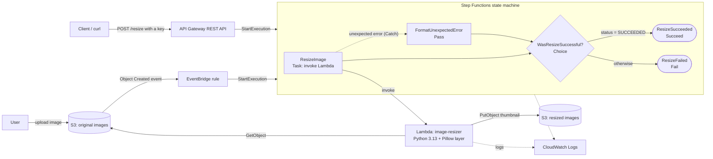
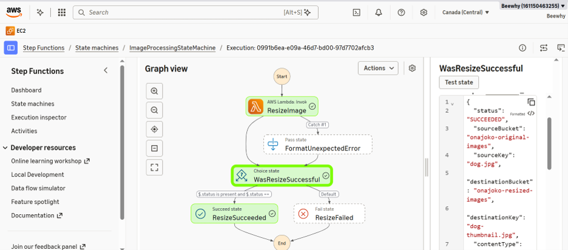
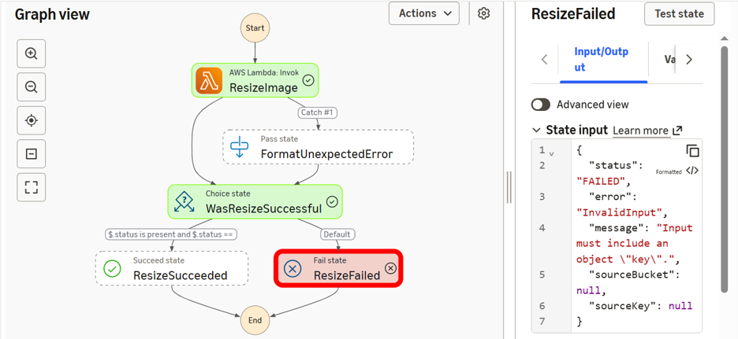
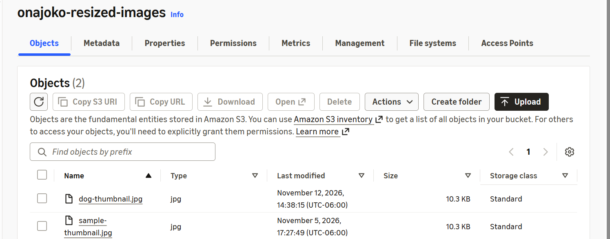

# Serverless Image Processing Pipeline

An AWS serverless application that turns every image uploaded to an S3 bucket into a thumbnail.
Uploads (or a call to a REST endpoint) start an AWS Step Functions workflow that invokes a
Python Lambda function using **Pillow** and saves the thumbnail in a second S3 bucket.

**Author:** Adebayo Onajoko · Cloud Computing capstone project

**Services:** Amazon S3 · AWS Lambda · AWS Step Functions · Amazon API Gateway · Amazon EventBridge · Amazon CloudWatch

**Demo video:** [Watch the demo](https://drive.google.com/file/d/1FG1RQ1IHR-THI6_v_vhOq1Zj8MtOWm3z/view?usp=sharing)

---

## Architecture



**Flow**

1. An image lands in the *original* bucket. S3 sends an `Object Created` event to EventBridge.
2. An EventBridge rule (or a `POST /resize` request through API Gateway) starts the state machine.
3. The **ResizeImage** Task invokes the Lambda function, which downloads the image, fixes its
   EXIF orientation, shrinks it to fit 200 × 200 px (aspect ratio kept) and writes
   `<name>-thumbnail.<ext>` to the *resized* bucket.
4. The **WasResizeSuccessful** Choice state reads the function's `status` and goes to
   **ResizeSucceeded** (Succeed) or **ResizeFailed** (Fail).
5. Lambda and Step Functions log to CloudWatch.

| Input | Result |
| --- | --- |
| JPEG, PNG, GIF, WebP image | Thumbnail in the resized bucket, execution **Succeeded** |
| Non-image file, unsupported format (e.g. TIFF), missing object, file > 20 MB | Execution **Failed** with a clear error (`InvalidImage`, `UnsupportedFormat`, `ObjectNotFound`, `ObjectTooLarge`) |
| Lambda throttled / transient service error | Retried 3 times with exponential backoff |

---

## Live deployment

The pipeline is deployed in **Canada (Central), `ca-central-1`**, built through the AWS Console
(see [How it was deployed](#how-it-was-deployed-aws-console)).

| Resource | Name / value |
| --- | --- |
| Region | `ca-central-1` |
| Original images bucket | `onajoko-original-images` |
| Resized images bucket | `onajoko-resized-images` |
| Lambda function | `image-resizer` (Python 3.13, x86_64, 512 MB, 30 s timeout) |
| Lambda layer | `pillow-py313` (Pillow 12.3.0), version 1 |
| State machine | `ImageProcessingStateMachine` (Standard) |
| State machine ARN | `arn:aws:states:ca-central-1:161150463255:stateMachine:ImageProcessingStateMachine` |
| EventBridge rule | `image-uploaded-rule` (default event bus) |
| REST API | `image-pipeline-api`, resource `/resize`, method `POST`, stage `prod` |
| API endpoint | `https://64fx8iw31k.execute-api.ca-central-1.amazonaws.com/prod/resize` |

> The endpoint is open (no API key) for grading purposes. All resources will be deleted after
> the course is graded.

### Screenshots

| Successful execution | Failed execution (bad input) | Thumbnail in resized bucket |
| --- | --- | --- |
|  |  |  |

---

## Repository structure

```
.
├── src/image_resizer/
│   ├── app.py                 # Lambda handler (Pillow thumbnail logic)
│   ├── Makefile               # `sam build` step for the function (copies app.py)
│   └── requirements.txt       # function deps (none: boto3 is in the runtime)
├── layers/pillow/
│   ├── requirements.txt       # Pillow==12.3.0
│   └── Makefile               # builds Lambda-compatible wheels during `sam build`
├── statemachine/
│   └── image_processing.asl.json   # Step Functions definition (Amazon States Language)
├── events/                    # sample inputs for testing
├── samples/                   # sample.jpg (success) and notes.txt (failure)
├── scripts/build_layer.sh     # builds/publishes the Pillow layer for console deployments
├── tests/test_app.py          # unit tests (S3 mocked in memory)
├── docs/                      # screenshots
├── template.yaml              # AWS SAM template: the whole stack as code
├── requirements-dev.txt
├── LICENSE
└── README.md
```

> **Note on file names.** In the Lambda console the code lives in `lambda_function.py` with
> handler `lambda_function.lambda_handler`. In this repository the same code is `app.py` with
> handler `app.lambda_handler`, which is what `template.yaml` and the unit tests use.
>
> `statemachine/image_processing.asl.json` uses the placeholder `${ImageResizerFunctionArn}`,
> which AWS SAM fills in at deploy time. For the console deployment this placeholder was replaced
> with `arn:aws:lambda:ca-central-1:161150463255:function:image-resizer`.

---

## Prerequisites

- An AWS account and an IAM user/role allowed to create S3, Lambda, Step Functions,
  API Gateway, EventBridge, IAM and CloudWatch resources.
- **AWS CloudShell** (in the console's top bar). It has the AWS CLI, Python, pip, zip, make
  and the SAM CLI preinstalled, so nothing needs installing locally.
- Optional, for local use: [AWS CLI v2](https://docs.aws.amazon.com/cli/latest/userguide/getting-started-install.html),
  [AWS SAM CLI](https://docs.aws.amazon.com/serverless-application-model/latest/developerguide/install-sam-cli.html),
  and Python 3.13 to run the unit tests.

> **Why a layer?** Pillow contains compiled C code. The layer is built from Linux
> `manylinux_2_28_x86_64` wheels so it runs on the Amazon Linux 2023 based `python3.13`
> runtime, whatever OS you build on. Pillow 12 publishes no `manylinux2014` wheels, so older
> instructions using `--platform manylinux2014_x86_64` fail.
>
> **The function's runtime must match the layer.** A layer built for Python 3.13 fails on a
> Python 3.14 function with `cannot import name '_imaging' from 'PIL'`. This happened during
> development and was fixed by setting the function runtime to Python 3.13.

---

## How it was deployed (AWS Console)

All steps were done in `ca-central-1`.

### 1. S3 buckets

1. Create `onajoko-original-images` and `onajoko-resized-images` (Block all public access on,
   SSE-S3 encryption).
2. On the **original** bucket only: **Properties → Amazon EventBridge → Edit → On**.

### 2. Pillow layer (CloudShell)

```bash
mkdir -p pillow-layer/python
python3 -m pip install Pillow==12.3.0 \
  --platform manylinux_2_28_x86_64 --implementation cp \
  --python-version 3.13 --only-binary=:all: \
  --target pillow-layer/python
cd pillow-layer && zip -qr9 ../pillow-layer.zip python && cd ..
aws lambda publish-layer-version --layer-name pillow-py313 \
  --zip-file fileb://pillow-layer.zip \
  --compatible-runtimes python3.13 --compatible-architectures x86_64
```

(`scripts/build_layer.sh --publish` does the same in one command.)

### 3. Lambda function `image-resizer`

- Runtime **Python 3.13**, architecture **x86_64**, memory **512 MB**, timeout **30 s**.
- Code: `src/image_resizer/app.py`. Layer: `pillow-py313`.
- Environment variables:

| Key | Value |
| --- | --- |
| `SOURCE_BUCKET` | `onajoko-original-images` |
| `DESTINATION_BUCKET` | `onajoko-resized-images` |
| `THUMBNAIL_MAX_SIZE` | `200` |

- Inline policy `image-resizer-s3-access` added to the function's execution role:

```json
{
  "Version": "2012-10-17",
  "Statement": [
    { "Sid": "ReadOriginals", "Effect": "Allow", "Action": "s3:GetObject",
      "Resource": "arn:aws:s3:::onajoko-original-images/*" },
    { "Sid": "ListOriginalsSoMissingKeysReturn404", "Effect": "Allow", "Action": "s3:ListBucket",
      "Resource": "arn:aws:s3:::onajoko-original-images" },
    { "Sid": "WriteThumbnails", "Effect": "Allow", "Action": "s3:PutObject",
      "Resource": "arn:aws:s3:::onajoko-resized-images/*" }
  ]
}
```

### 4. State machine `ImageProcessingStateMachine`

- Type **Standard**, definition from `statemachine/image_processing.asl.json` with the
  function ARN filled in. Role created by the console (`lambda:InvokeFunction` on `image-resizer`).

### 5. EventBridge rule `image-uploaded-rule`

- Event pattern:

```json
{
  "source": ["aws.s3"],
  "detail-type": ["Object Created"],
  "detail": { "bucket": { "name": ["onajoko-original-images"] } }
}
```

- Target: Step Functions state machine `ImageProcessingStateMachine`, with a role created by the
  console.

### 6. API Gateway `image-pipeline-api`

1. IAM role `apigw-start-stepfunctions-role` (trusted entity: API Gateway) with inline policy
   `start-image-pipeline`:

```json
{
  "Version": "2012-10-17",
  "Statement": [
    { "Effect": "Allow", "Action": "states:StartExecution",
      "Resource": "arn:aws:states:ca-central-1:161150463255:stateMachine:ImageProcessingStateMachine" }
  ]
}
```

2. REST API (Regional) → resource `/resize` → method `POST`, integration type **AWS service**,
   service **Step Functions**, action **StartExecution**, execution role
   `apigw-start-stepfunctions-role`.
3. Integration request mapping template for `application/json`:

```velocity
## Forward the JSON request body as the execution input.
#set($body = $util.escapeJavaScript($input.json('$')).replaceAll("\\'", "'"))
{
  "stateMachineArn": "arn:aws:states:ca-central-1:161150463255:stateMachine:ImageProcessingStateMachine",
  "input": "$body"
}
```

4. **Deploy API** to stage `prod`.

---

## Usage and testing

```bash
ORIGINAL=onajoko-original-images
RESIZED=onajoko-resized-images
API_URL=https://64fx8iw31k.execute-api.ca-central-1.amazonaws.com/prod/resize
```

### 1. Upload an image (automatic trigger)

```bash
aws s3 cp samples/sample.jpg "s3://$ORIGINAL/sample.jpg"
sleep 10
aws s3 ls "s3://$RESIZED/"        # -> sample-thumbnail.jpg
```

Open **Step Functions → State machines → ImageProcessingStateMachine** to see the execution
graph: `ResizeImage → WasResizeSuccessful → ResizeSucceeded`.

### 2. Trigger through the API

```bash
curl -s -X POST "$API_URL" \
  -H "Content-Type: application/json" \
  -d '{"key": "sample.jpg"}'
# {"executionArn":"arn:aws:states:ca-central-1:...:execution:ImageProcessingStateMachine:...","startDate":...}
```

The API starts the workflow asynchronously and returns the `executionArn`. Check its result:

```bash
aws stepfunctions describe-execution --execution-arn "<executionArn>" \
  --query '{status:status, output:output}'
```

### 3. Failure path

```bash
aws s3 cp samples/notes.txt "s3://$ORIGINAL/notes.txt"     # not an image
curl -s -X POST "$API_URL" -H "Content-Type: application/json" -d '{"key":"missing.jpg"}'
```

Both executions end in **ResizeFailed** with `InvalidImage` and `ObjectNotFound` errors.

### 4. Test results

| Test | Trigger | Result |
| --- | --- | --- |
| Upload `dog.jpg` | S3 → EventBridge | Succeeded; `dog-thumbnail.jpg` created |
| `POST /resize {"key": "dog.jpg"}` | API Gateway | 200 with `executionArn`; execution Succeeded |
| Lambda console test `{"key": "sample.jpg"}` | Direct invoke | `SUCCEEDED`, 656 × 984 → 133 × 200 px |
| Missing or invalid file | API / upload | Execution Failed at `ResizeFailed` with a clear error |

### 5. Unit tests

```bash
python3 -m venv .venv && source .venv/bin/activate
pip install -r requirements-dev.txt
python -m pytest -v        # 10 passed
```

---

## Alternative: deploy with AWS SAM

`template.yaml` defines the same stack as code (buckets, layer, function, state machine,
EventBridge rule and API, with least-privilege IAM). It creates a **separate** copy of the
pipeline with its own resource names. Run in CloudShell:

```bash
git clone https://github.com/YOUR-GITHUB-USERNAME/serverless-image-pipeline.git
cd serverless-image-pipeline
sam validate --lint
sam build
sam deploy --guided --stack-name image-pipeline
```

Answer the prompts with Region `ca-central-1`, `y` to confirm changes and allow IAM role
creation, `n` to disable rollback, `y` to "may not have authorization defined" (if asked) and to
saving the configuration. The stack **Outputs** list the bucket names, state machine ARN and API
URL. Remove it with `sam delete --stack-name image-pipeline` after emptying both buckets.

---

## Configuration

Environment variables of the Lambda function:

| Variable | Default | Purpose |
| --- | --- | --- |
| `SOURCE_BUCKET` | (required) | Only objects in this bucket are processed |
| `DESTINATION_BUCKET` | (required) | Where thumbnails are written |
| `THUMBNAIL_MAX_SIZE` | `200` | Longest side of the thumbnail in px |
| `MAX_INPUT_BYTES` | `20971520` (20 MB) | Larger files are rejected |
| `LOG_LEVEL` | `INFO` | Python logging level |

---

## Design decisions

- **EventBridge instead of a direct S3 → Lambda trigger**, so every upload runs through the
  Step Functions workflow (Task → Choice → Succeed/Fail) and appears in its execution history.
- **Two buckets** keep inputs and outputs separate, so writing a thumbnail can never re-trigger
  the pipeline (no recursive loop).
- **Expected errors are returned, unexpected errors are raised.** The function returns
  `{"status":"FAILED", "error", "message"}` for bad input; the state machine's `Catch` converts
  any other error into the same shape, so the Choice state has one field to check.
- **Least-privilege IAM:** the function can only read the original bucket and write the resized
  bucket; API Gateway can only start this one state machine.
- **API Gateway calls Step Functions directly** (no extra Lambda), using a VTL mapping template.
- **Standard workflow** for full, visual execution history.
- **Pinned dependency** (`Pillow==12.3.0`) for reproducible builds.

---

## Troubleshooting

| Symptom | Fix |
| --- | --- |
| `No module named 'PIL'` | The layer is not attached, or was built for another Python version. |
| `cannot import name '_imaging' from 'PIL'` | The function runtime doesn't match the layer (e.g. Python 3.14 function, 3.13 layer), or the layer contains macOS/Windows wheels. Set the runtime to Python 3.13 or rebuild the layer. |
| Upload does not start an execution | EventBridge notifications must be **On** for the original bucket; the rule and bucket must be in the same Region. |
| API returns `AccessDeniedException` | The API Gateway role lacks `states:StartExecution` on the state machine. |
| API changes have no effect | Redeploy the API to the `prod` stage. |
| `ObjectNotFound` for a file that exists | Check the exact key (case, folder). Keys with spaces must be sent unencoded in the API body. |
| `Task timed out` | Increase the function timeout/memory for very large images. |

---

## Clean up

After grading, empty both buckets, then delete the API, EventBridge rule, state machine, Lambda
function, layer versions, buckets, the IAM roles created for this project and the CloudWatch log
groups.

```bash
aws s3 rm s3://onajoko-original-images --recursive
aws s3 rm s3://onajoko-resized-images --recursive
```

---

## License

[MIT](LICENSE) © 2026 Adebayo Onajoko
